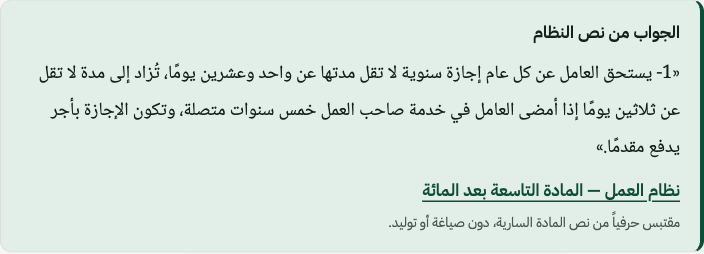
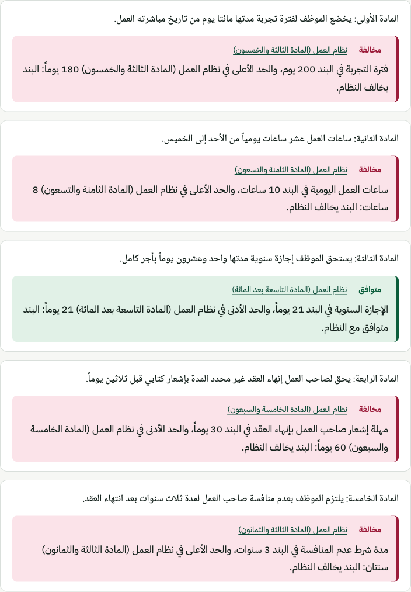

# Masdar · مصدر

**Arabic-first legal search, answers and contract checking over Saudi regulations, built for HR,
legal and compliance teams.** It covers the Labor Law, the Personal Data Protection Law (PDPL) and
the Companies Law, as they are **in force** after amendments, and it runs on local models only:
no LLM, no API key, nothing generated.

> محرّك عربي للأنظمة السعودية لفرق الموارد البشرية والقانونية والامتثال: يبحث في النص الساري، ويجيب بجملة مقتبسة حرفياً من المادة، ويفحص العقود والسياسات مقابل حدود نظام العمل، مع الاستشهاد دائماً.

| | What it does | Interfaces |
|---|---|---|
| **Search** | Question in Arabic (formal or dialect) → ranked articles, each with status (in force, amended, review needed) and its decree | web, `GET /api/search`, `masdar search`, MCP `search_regulations` |
| **Answer** | Quotes the sentence of the law that answers, verbatim, with the citation, or says it found none | web, `GET /api/answer`, `masdar answer`, MCP `answer_question` |
| **Check a contract** | Splits a contract or HR policy into clauses and flags any that breaks a Labor Law limit, citing the article | web, `POST /api/check`, `masdar check`, MCP `check_contract` |

<p align="center">
  
</p>

## Why it is hard
- **Arabic breaks naive search.** The same word appears with or without diacritics, with
  different alef and hamza forms, stretched with tatweel, and with Arabic-Indic or Latin
  digits. Exact string matching misses most of these variants.
- **The published text is not the law in force.** The official portal shows each law in its
  original wording and attaches amendments as free-text notes. Indexing it as published would
  serve **50 of 211** current Labor Law articles and **12 of 42** PDPL articles in outdated form
  (measured by `make dataset`, see the [dataset card](data/dataset/DATASET_CARD.md)). Masdar resolves amendments
  (replace, add, repeal, renumber, consolidate) by decree date and flags partial ones instead
  of guessing ([ADR-0005](docs/decisions/0005-amendment-resolution.md)).
- **Compliance needs citations, not paraphrases.** An answer is only useful if it points to
  the exact article.
- **Quality must be measured.** Every retrieval change is scored against a hand-written gold
  set, so improvements are proven with numbers rather than claimed.

## Approach
| Stage | Technique | Status |
|---|---|---|
| Ingestion | Official HTML (هيئة الخبراء), committed gzip snapshots, Arabic ordinal headings to numbers | ✅ |
| Amendments | Versioned articles: text in force derived from decree-dated notes, with a status per article | ✅ |
| Normalization | Rule-based Arabic normalizer (NFKC, diacritics, alef/yaa/taa folding, digits) | ✅ |
| Chunking | Structure-aware (paragraph boundaries) + contextual prefix (law/part/chapter) | ✅ |
| Lexical retrieval | BM25 + Arabic light stemming (light10) and stopwords | ✅ |
| Dense retrieval | `multilingual-e5-small`, local, cached embeddings | ✅ |
| Fusion and reranking | Reciprocal Rank Fusion; cross-encoder reranker (`mmarco-mMiniLMv2`) | ✅ |
| Evaluation | Recall@k, MRR, graded nDCG@10 on a versioned gold set; regression gate | ✅ |
| Answers | Extractive: the best sentence of the top articles, scored by the same cross-encoder; abstains below a cross-validated threshold | ✅ |
| Contract checker | Clause splitting, Arabic quantity extraction, rules as code pinned to the text in force; blind-set evaluation | ✅ |
| Interfaces | Arabic web UI, REST API, CLI, **MCP server** (search, answer, check, article lookup) | ✅ |

Each technique is tied to its paper in [docs/RESEARCH.md](docs/RESEARCH.md).

## Dataset: Saudi Regulations Arabic Retrieval Benchmark
A BEIR-format corpus of **534 current articles** (plus 42 repealed or superseded ones in
`history.jsonl`), each with its status as current law, its original
wording, and every amendment (decree, Hijri date, note). Full schema and counts are in the
generated [dataset card](data/dataset/DATASET_CARD.md).

| Law | Articles | Current | Amended (applied) | Review needed | Repealed |
|---|---|---|---|---|---|
| نظام العمل (Labor Law) | 252 | 211 | 53 | 18 | 29 |
| نظام حماية البيانات الشخصية (PDPL) | 43 | 42 | 12 | 11 | 1 |
| نظام الشركات (Companies Law) | 281 | 281 | 0 | 0 | 0 |

It ships with **82 hand-written HR and compliance questions** and graded relevance judgments
(2 = answers, 1 = related) in three styles: 50 formal, 17 Saudi dialect, and 15 paraphrases that
avoid the law's own wording (for example "الأوفرتايم").

## Results

Everything below is measured by `make eval` and written to `eval/`; a test fails if any number in
this README differs from those files.

### Search
nDCG@10, Recall@10 and MRR@10 at article level on the 82 gold questions. Every number below
comes from `eval/results/*.json` (written by `make eval`), and a test fails if this table and
those files ever disagree. The full breakdown by style and by law is in
[eval/RESULTS.md](eval/RESULTS.md).

| Pipeline | nDCG@10 | Recall@10 | MRR@10 | Dialect nDCG@10 |
|---|---|---|---|---|
| `bm25-raw` | 0.578 | 0.701 | 0.565 | 0.341 |
| `bm25` | 0.796 | 0.890 | 0.792 | 0.644 |
| `dense` | 0.862 | 0.957 | 0.868 | 0.796 |
| `hybrid(bm25+dense)` | 0.850 | 0.921 | 0.847 | 0.730 |
| `hybrid(bm25+dense)+rerank` | 0.925 | 0.970 | 0.930 | 0.869 |
| **`dense+rerank`** (served) | **0.932** | **0.970** | **0.935** | **0.923** |

- **Arabic-aware lexical search matters.** Normalization, the contextual prefix and light10
  stemming take BM25 from 0.578 to 0.796 ([ADR-0006](docs/decisions/0006-lexical-retrieval-and-evaluation.md)).
- **Meaning beats words for dialect.** Dense retrieval lifts dialect questions from 0.644 to
  0.796, and the cross-encoder takes them to 0.923.
- **Fusion did not pay here.** Hybrid + rerank (0.925) is within noise of dense + rerank, so
  the simpler pipeline is served ([ADR-0007](docs/decisions/0007-semantic-retrieval-hybrid-and-reranking.md)).
- **Read with care.** One annotator and 82 questions: differences below about 0.02 are noise,
  and models were chosen on this same set, so the absolute numbers are somewhat optimistic.

### Answers ([ADR-0009](docs/decisions/0009-extractive-answers-and-abstention.md))
The answer is a sentence copied from the article in force, so it cannot state anything the law
does not say. Below a confidence threshold it refuses instead of guessing.

| Measured on | Quote from a correct article | Wrong answer | Refused when the law has the answer | Refused when it does not |
|---|---|---|---|---|
| 82 gold + 32 out-of-scope questions | 0.817 | 0.000 | 0.171 | 0.969 |

The threshold was chosen by two-fold cross-validation; on the held-out folds the wrong-answer rate
was 1.4% (ADR-0009). Refusals are uneven: dialect questions are refused far more often than formal
ones, because the small reranker is sensitive to wording.

### Contract checker ([ADR-0010](docs/decisions/0010-contract-checker-rules-as-code.md))
16 quantitative Labor Law limits (probation, notice, leave, working hours, non-compete, loan
deductions…), each pinned by a test to the article's text **in force**. Five of them differ from
the text the official portal displays (for example probation 90 → 180 days, maternity leave 10 →
12 weeks). Anything uncertain is "review needed", never a verdict.

| Clause set | Written by | Violation precision | Violation recall | Compliant precision |
|---|---|---|---|---|
| `development` | the rules' author | 1.00 | 1.00 | 1.00 |
| `blind-v2` | an independent author, after v2 | 1.00 | 0.28 | 0.91 |

**A flag is reliable; silence is not.** Across two independently written blind sets the checker
never called a compliant clause a violation, but it finds only a minority of violations worded in
ways it has not seen. The product says so, and ADR-0010 records every blind measurement as taken.

<p align="center">
  
</p>

## Quickstart
```bash
make setup     # install dependencies, including the local models' extra, and git hooks
make serve     # web UI and API on http://localhost:8000 (first start downloads two ~0.47 GB models)
uv run masdar answer "كم الإجازة السنوية للعامل؟"
uv run masdar check contract.txt   # or: cat contract.txt | uv run masdar check -
make eval      # score every pipeline on the gold set -> eval/RESULTS.md
make check     # lint, types, architecture rules, tests
make dataset   # rebuild the corpus offline from committed snapshots (byte-identical)
```

`MASDAR_PIPELINE=bm25` serves the lexical pipeline with no model download.

### Use it from an AI agent (MCP)
`make mcp` starts a stdio MCP server with four read-only tools: `search_regulations`
(question → ranked, cited articles with their status), `answer_question` (the verbatim quote or a
refusal), `check_contract` (clause-by-clause verdicts with citations) and `get_article` (full text
in force and amendment history). Any MCP client, such as Claude Desktop, can launch it with
`uv run --directory /path/to/masdar masdar-mcp`.

## Engineering
- **Architecture:** ports and adapters. The domain is pure Python, and the boundaries are
  enforced in CI by `import-linter`. See [ARCHITECTURE](docs/ARCHITECTURE.md).
- **Quality gates:** ruff (strict), `mypy --strict`, pytest with property-based tests
  (Hypothesis), coverage of at least 85%, dependency audit and secret scanning.
- **Decisions:** every non-obvious choice is recorded as an ADR in
  [docs/decisions](docs/decisions/).

## Documentation
| Doc | For |
|---|---|
| [ARCHITECTURE.md](docs/ARCHITECTURE.md) | How the system fits together |
| [RESEARCH.md](docs/RESEARCH.md) | The papers behind each technique |
| [LEARNING.md](docs/LEARNING.md) | Concepts explained step by step (Arabic) |
| [INTERVIEW.md](docs/INTERVIEW.md) | Likely interview questions with answers (Arabic) |
| [AGENTS.md](AGENTS.md) | Rules for contributors and AI assistants |
