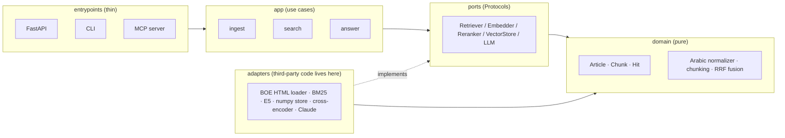

# Architecture

## Layers
Masdar follows ports and adapters (hexagonal architecture). Dependencies point inward only,
and `import-linter` enforces the rule in CI. The reasoning is in
[ADR-0001](decisions/0001-ports-and-adapters.md).



| Folder | Responsibility | May import |
|---|---|---|
| `domain/` | Models, Arabic text logic, ranking math. No I/O. | stdlib only |
| `ports/` | `typing.Protocol` interfaces the app depends on | `domain` |
| `adapters/` | Concrete implementations (files, models, APIs) | `ports`, `domain`, third-party |
| `app/` | Use cases that orchestrate ports | `ports`, `domain` |
| `entrypoints/` | HTTP, CLI and MCP surfaces | `app`, `container` |
| `container.py` | Composition root: builds adapters and injects them | everything |

## Data flow

**Indexing (offline)**
```
BOE HTML ──loader──► Article ──chunker──► Chunk(text, normalized_text) ──► BM25 index
                                                                     └──► embeddings ──► vector store
```

**Query (online)**
```
question ─► normalize ─┬─► BM25 top-k ──┐
                       └─► dense top-k ─┴─► RRF fusion ─► cross-encoder rerank ─► Hits + citations
```

## Two texts per chunk
Normalization is lossy (for example ة becomes ه), so every `Chunk` carries the original `text`
for display and citations, and a separate `normalized_text` used only for matching. See
[ADR-0003](decisions/0003-arabic-normalization.md).

## Built so far
| Layer | Module | What it does |
|---|---|---|
| domain | `models.py` | `Article` (text in force, status, history), `Chunk`, `Hit` |
| domain | `arabic.py` | `ArabicNormalizer`, configurable and idempotent |
| domain | `ordinals.py` | Arabic ordinal headings to `ArticleNumber` (bis, renumbered) |
| domain | `amendments.py` | Classify amendment notes and resolve the text in force (ADR-0005) |
| domain | `articles.py` | Build articles from raw blocks; articles that exist only inside notes |
| domain | `chunking.py` | Paragraph-aware chunks with a contextual search prefix |
| domain | `dataset.py` | Dataset report (counts per law and status) |
| ports | `law_source.py`, `dataset_writer.py` | Where laws come from and where datasets go |
| adapters | `boe/` | Catalog, polite HTTP client with gzip snapshots, read-only HTML parser |
| adapters | `beir_writer.py` | BEIR `corpus.jsonl`, `stats.json`, generated dataset card |
| app | `build_dataset.py` | Load, resolve, validate integrity, write |
| entrypoints | `cli.py` | `masdar dataset [--offline \| --refresh] [--laws ...]` |
| root | `config.py`, `container.py` | Validated settings and the composition root |

**Dataset flow:** `BoeClient` (snapshot or HTTP) → `parse_law_html` → `PublishedLaw` →
`build_articles` (ordinals + amendments) → integrity check → `BeirDatasetWriter`.
