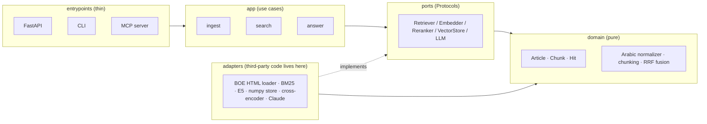

# Architecture

## Layers
Masdar follows ports and adapters (hexagonal architecture). Dependencies point inward only,
and `import-linter` enforces the rule in CI. The reasoning is in
[ADR-0001](decisions/0001-ports-and-adapters.md).



| Folder | Responsibility | May import |
|---|---|---|
| `domain/` | Models, Arabic text logic, ranking math. No I/O. | stdlib only |
| `ports/` | `typing.Protocol` interfaces the app depends on | `domain` |
| `adapters/` | Concrete implementations (files, models, APIs) | `ports`, `domain`, third-party |
| `app/` | Use cases that orchestrate ports | `ports`, `domain` |
| `entrypoints/` | HTTP, CLI and MCP surfaces | `app`, `container` |
| `container.py` | Composition root: builds adapters and injects them | everything |

## Data flow

**Indexing (offline)**
```
BOE HTML ──loader──► Article ──chunker──► Chunk(text, normalized_text) ──► BM25 index
                                                                     └──► embeddings ──► vector store
```

**Query (online)**
```
question ─► normalize ─┬─► BM25 top-k ──┐
                       └─► dense top-k ─┴─► RRF fusion ─► cross-encoder rerank ─► Hits + citations
```

## Two texts per chunk
Normalization is lossy (for example ة becomes ه), so every `Chunk` carries the original `text`
for display and citations, and a separate `normalized_text` used only for matching. See
[ADR-0003](decisions/0003-arabic-normalization.md).

## Built so far
| Layer | Module | What it does |
|---|---|---|
| domain | `models.py` | `Article` (text in force, status, history), `Chunk`, `Hit` |
| domain | `arabic.py` | `ArabicNormalizer`, configurable and idempotent |
| domain | `ordinals.py` | Arabic ordinal headings to `ArticleNumber` (bis, renumbered) |
| domain | `amendments.py` | Classify amendment notes and resolve the text in force (ADR-0005) |
| domain | `articles.py` | Build articles from raw blocks; articles that exist only inside notes |
| domain | `chunking.py` | Paragraph-aware chunks with a contextual search prefix |
| domain | `dataset.py` | Dataset report (counts per law and status) |
| domain | `tokenize.py` | Arabic tokenizer, stopwords, light10 stemmer (ADR-0006) |
| domain | `metrics.py`, `evaluation.py` | Recall@k, MRR@10, graded nDCG@10; per-style and per-law reports |
| domain | `fusion.py` | Reciprocal Rank Fusion with optional weights (ADR-0007) |
| domain | `gold.py`, `search.py` | Gold questions; collapse chunk hits to ranked articles |
| ports | `law_source.py`, `dataset_writer.py`, `gold_source.py` | Where laws, gold questions come from and where datasets go |
| ports | `retriever.py`, `reranker.py` | First-stage retrieval and second-stage reranking |
| adapters | `boe/` | Catalog, polite HTTP client with gzip snapshots, read-only HTML parser |
| adapters | `beir_writer.py` | BEIR `corpus.jsonl`, `stats.json`, generated dataset card |
| adapters | `bm25.py` | `Bm25Retriever` (rank-bm25) with one analyzer for documents and queries |
| adapters | `dense.py` | `DenseRetriever`: mE5-small, E5 prefixes, fingerprinted embedding cache |
| adapters | `cross_encoder.py` | `CrossEncoderReranker`: mmarco-mMiniLMv2, pairs truncated to 256 tokens |
| domain | `answer.py` | Verbatim sentence splitting, `Evidence` (must quote its article), `Answer`, answer quality report (ADR-0009) |
| adapters | `out_of_scope_jsonl.py` | Questions the corpus does not answer, for measuring abstention |
| app | `answer.py` | `AnswerService`: quote the best sentences of the law or refuse below a calibrated threshold |
| domain | `quantities.py` | Arabic quantities (digits, number words, duals, fractions, %) with spans |
| domain | `compliance.py`, `labor_rules.py` | Clause splitting, conservative rule matching; 16 Labor Law limits pinned to the text in force (ADR-0010) |
| domain | `checker_quality.py` | Per-verdict precision and recall on labeled clauses |
| adapters | `clauses_jsonl.py` | Labeled clauses (development and blind sets) |
| app | `check_contract.py` | `CheckContract`: verdicts plus related articles per clause |
| ports | `pair_scorer.py` | Scores (question, passage) pairs; shared by reranking and answers |
| adapters | `eval_writer.py` | `eval/results/*.json`, generated `eval/RESULTS.md`, `eval/baseline.json` |
| app | `build_dataset.py` | Load, resolve, validate integrity, write |
| app | `evaluate.py` | Run a `SearchService` over the gold set and score articles |
| app | `search.py`, `hybrid.py` | `SearchService` (retrieve, rerank, collapse, filter); `HybridRetriever` |
| entrypoints | `cli.py` | `masdar dataset [--offline \| --refresh] [--laws ...]`, `masdar eval`, `masdar search` |
| entrypoints | `api.py`, `security.py`, `schemas.py` | FastAPI: `/api/search`, `/api/answer`, `/api/check`, `/api/laws`, `/api/health`; CSP, rate limit (ADR-0008) |
| entrypoints | `web/` | Arabic-first RTL search page, no framework, no inline script |
| entrypoints | `mcp_server.py` | MCP tools `search_regulations`, `answer_question`, `check_contract`, `get_article` for AI agents |
| root | `config.py`, `container.py` | Validated settings; composition root with the pipeline registry (`MASDAR_PIPELINE`) |

**Dataset flow:** `BoeClient` (snapshot or HTTP) → `parse_law_html` → `PublishedLaw` →
`build_articles` (ordinals + amendments) → integrity check → `BeirDatasetWriter`.

**Evaluation flow:** `LEXICAL_PIPELINES` (container) → `SearchService` → `Evaluate` (gold
questions → article rankings → `metrics`) → `EvaluationReport` → `EvalResultsWriter`.
